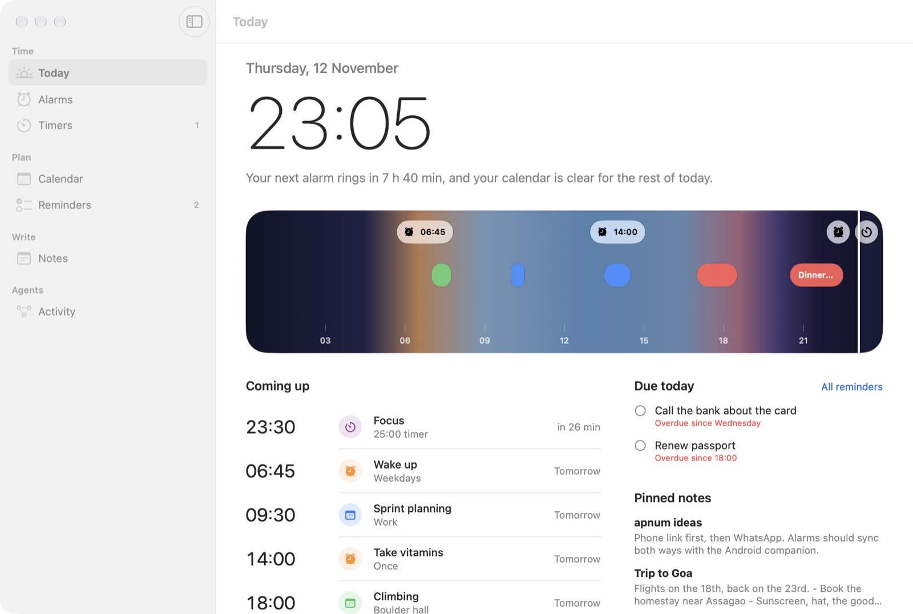
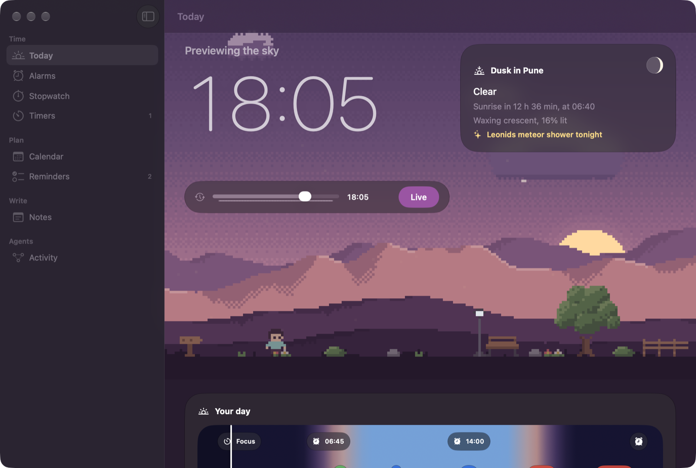
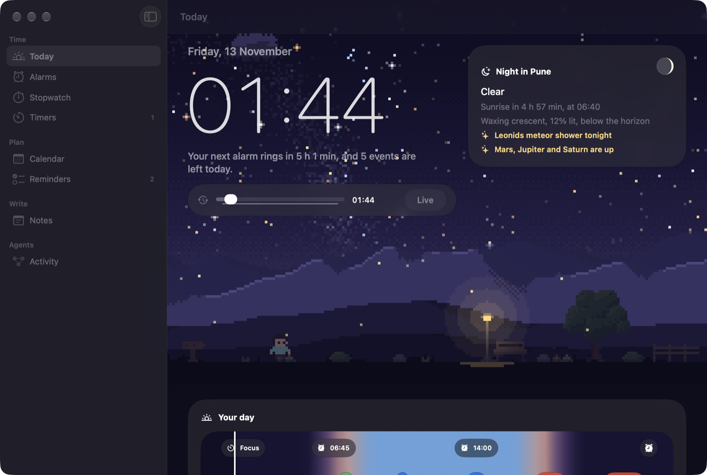
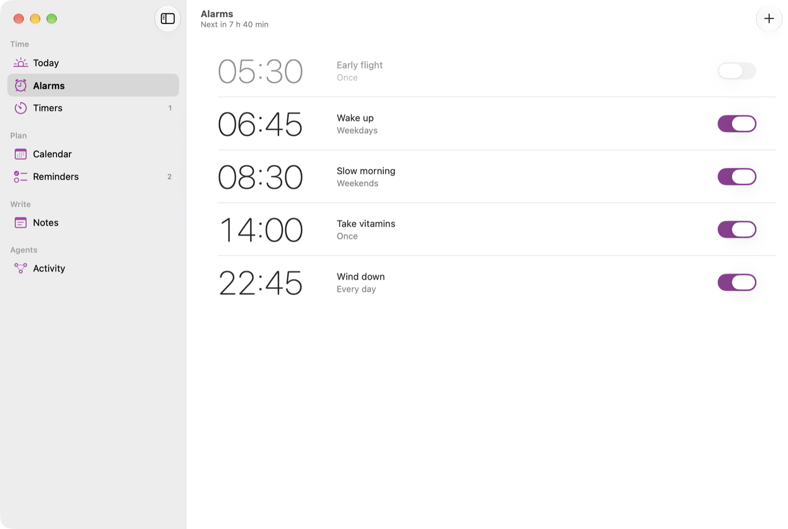
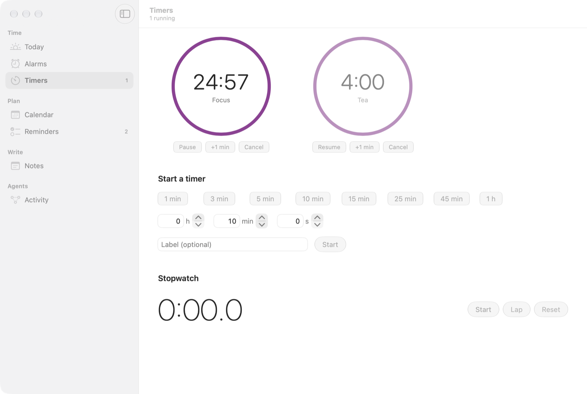
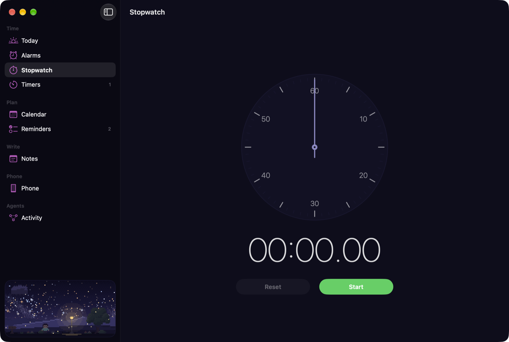
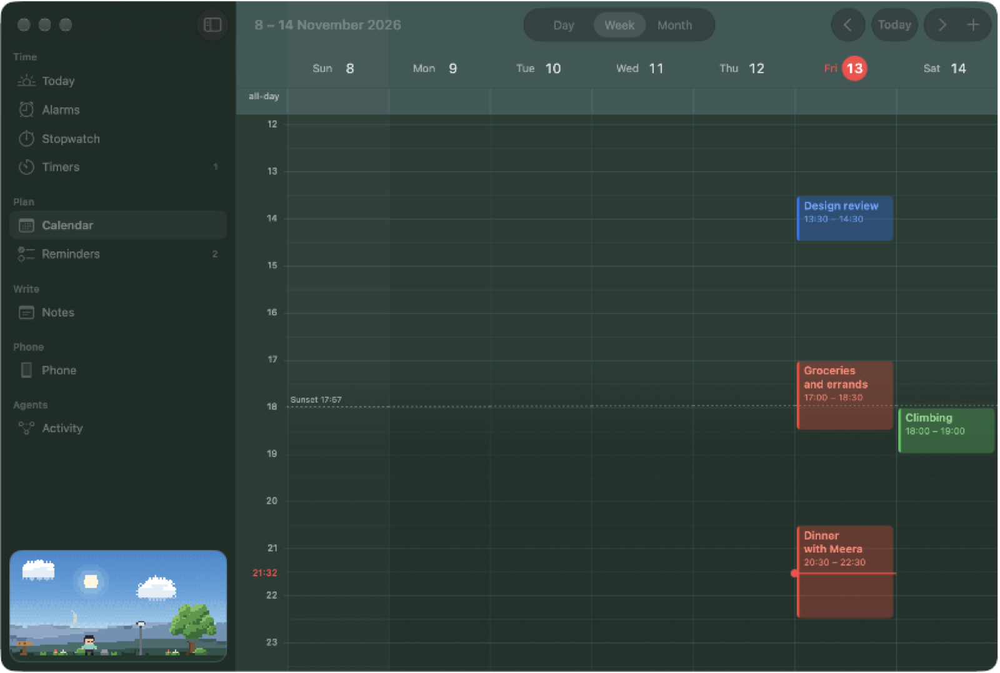
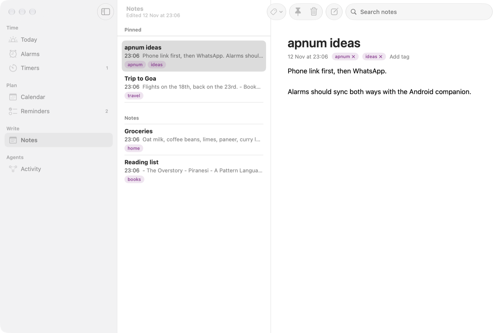
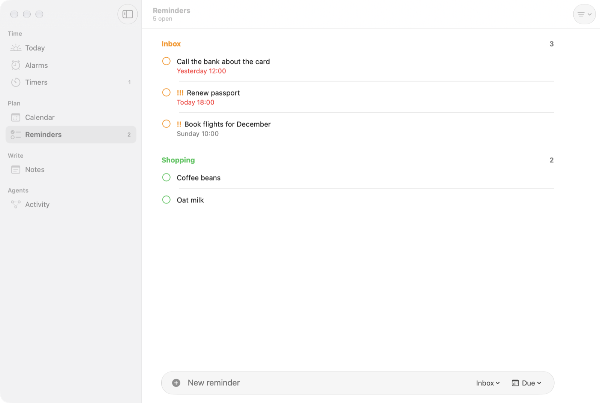
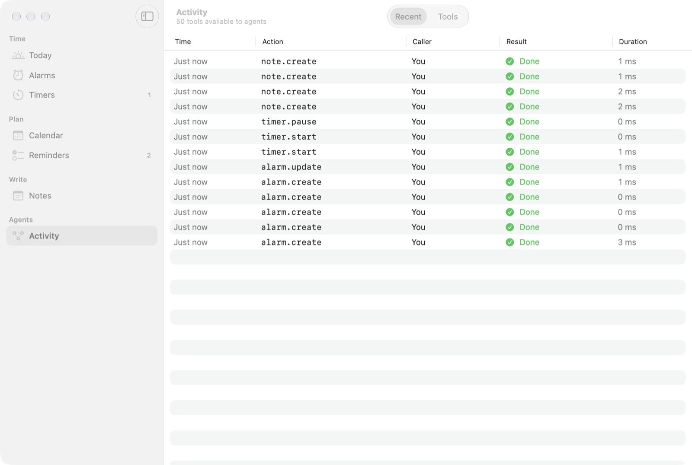

# apnum

A lightweight, open-source Mac app for one person's day: alarms, timers, notes, calendar, reminders and Mac controls, built from the start so AI agents can use every feature as a tool. It runs as a normal windowed app with a glance in the menu bar, designed for macOS 26 and Liquid Glass.



| Dusk | Night |
|---|---|
|  |  |

## The live sky

Today opens on a small pixel world under the real sky for your city, ported from [aarshj.me](https://aarshj.me):

- Colours follow the actual altitude of the sun, so dawn and dusk last as long as they really do where you are.
- The sun, the moon in its true phase, real stars, the Milky Way and the planets sit where they are right now; meteor showers, blood moons, supermoons and blue moons show up on their real dates.
- Live weather (Open-Meteo, coordinates only, optional) brings clouds, rain, fog and storms.
- A character wanders the hills, the lamp lights itself at night, and fireflies come out. Click them.
- Scrub the time slider to see the sky at any hour, and let the app's accent colour follow the sky.
- Agents can ask too: `sky.now` answers "when is sunset?" or "is the moon up?".

An Android companion app will follow, bringing the phone's SMS, OTPs, calls, notifications, files, WhatsApp and screen to the Mac, and letting the phone control the Mac in return.

> **Status:** early development. The Mac app works (alarms, timers, notes, calendar, reminders, Mac controls, 50 tools); the phone link and agent access come next.

| Alarms | Timers |
|---|---|
|  |  |
| **Stopwatch** | **Calendar** |
|  |  |
| **Notes** | **Reminders** |
|  |  |
| **Activity: every tool agents can use** | |
|  | |

## Features

| Area | Mac app | Phone (planned) |
|---|---|---|
| Alarms | apnum's own alarm clock; optional mirror into the macOS Clock app via Shortcuts | Full alarm clock in the companion app, synced both ways |
| Timers and stopwatch | Modelled on the macOS Clock app: recents, typed durations, rings, laps | Synced |
| Notes | Markdown files you own, with tags and search | Notes screen in the companion app, synced |
| Sky | Sun, moon, stars, planets, meteor showers and weather for your city, drawn as a living pixel scene | Same sky on the phone |
| Calendar and Reminders | Your real Apple Calendar (Day, Week, Month) and Reminders, iCloud and Google accounts included | Through the same Google account |
| Mac control | Volume, media keys, clipboard, lock, sleep, battery, open apps, run Shortcuts | Control the Mac from the phone |
| Phone | — | SMS, OTP, call control, notifications, files, WhatsApp, screen mirroring (scrcpy) |
| Agents | Every feature is a tool with a JSON schema | MCP server for Claude Code |

## Design

- **Every action is a tool.** The UI, AI agents and the phone all call the same `ToolRegistry`, so they share one permission policy and one audit log. Adding MCP later is a thin adapter.
- **Permission tiers.** Tools are `read`, `write` or `dangerous`. Agents and the phone cannot run dangerous tools without approval on the Mac.
- **Private by default.** Data stays on your Mac under `~/Library/Application Support/apnum`. The audit log never records tool inputs or outputs.
- **Lightweight.** Native Swift, no third-party dependencies, no polling: the app sleeps until the next alarm or timer is due. Target: 0% idle CPU, under 30 MB memory.
- **Native look.** System controls, your accent colour and Liquid Glass, with one signature: the Today screen paints the day as the sky. See [docs/design.md](docs/design.md).

See [CLAUDE.md](CLAUDE.md) for the architecture and contributor conventions.

## Build

Requires macOS 26 or later and Xcode 26 or later.

```sh
export DEVELOPER_DIR=/Applications/Xcode.app/Contents/Developer   # if xcode-select points at the Command Line Tools
scripts/build-rust.sh mac  # once, and after changing rust/: builds the Rust link core xcframework
swift test
scripts/bundle.sh          # creates build/Apnum.app
open build/Apnum.app
```

Try it with sample data, without touching your own: `open build/Apnum.app --env APNUM_DEMO=1 --env APNUM_HOME=/tmp/apnum-demo`. `scripts/snapshot.sh <screen> out.png [light|dark]` captures a screen in demo mode.

Set `APNUM_SIGN_IDENTITY` to a code-signing identity to keep macOS permission grants across rebuilds.

On first launch apnum asks for notification permission. Calendar and Reminders access is requested from the Agenda tab, and media keys need Accessibility access (Settings shows how).

Star and constellation data come from d3-celestial (BSD-3); see `Sources/ApnumSky/Resources/NOTICE.md`.

Data lives in `~/Library/Application Support/apnum` (`APNUM_HOME` overrides it): `alarms.json`, `timers.json`, `notes/*.md` and `audit.jsonl`.

## Rust core

`rust/apnum-link` holds the Noise XX encryption and pairing helpers shared with the Android app (UniFFI bindings for Swift and Kotlin). The xcframework is built into `build/` and not committed, so run `scripts/build-rust.sh mac` once before `swift build` (needs `rustup` with a stable toolchain). `scripts/build-rust.sh android` builds the `.so` files and Kotlin bindings (needs the Android NDK and `cargo-ndk`). Run its tests with `cargo test` in `rust/apnum-link`.

## Phone link

Pair an Android phone from the Phone screen (QR code or an 8-digit code) and the Mac can read its messages and one-time codes, show and dismiss notifications, place and end calls, ring it, and share the clipboard, while the phone can call the Mac's tools. Every action is a tool, so agents get the same access under the same permissions and audit log.

Traffic stays on your local network, encrypted and mutually authenticated with a Noise XX handshake (the shared Rust core); each side pins the other's key at pairing, and the phone cannot run dangerous Mac actions unless you allow it. The wire format is in [docs/link-protocol.md](docs/link-protocol.md).

## Mirroring alarms into the Clock app

Optional. See [docs/clock-shortcuts.md](docs/clock-shortcuts.md).

## Roadmap

1. Mac core: alarms, timers, notes, calendar, reminders, Mac control *(done, being polished)*
2. Android companion and encrypted Wi-Fi pairing: SMS, OTP, call control, notifications, alarms, notes
3. Phone files and screen mirroring
4. WhatsApp bridge
5. Agent access over MCP with approval prompts on the Mac

## License

[MIT](LICENSE)
